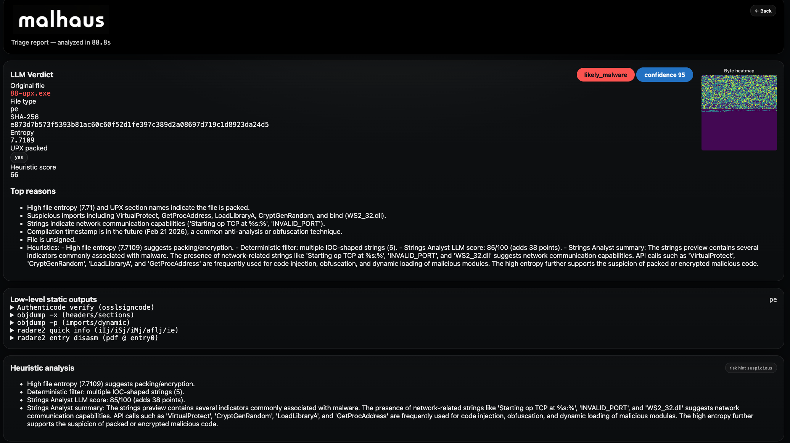
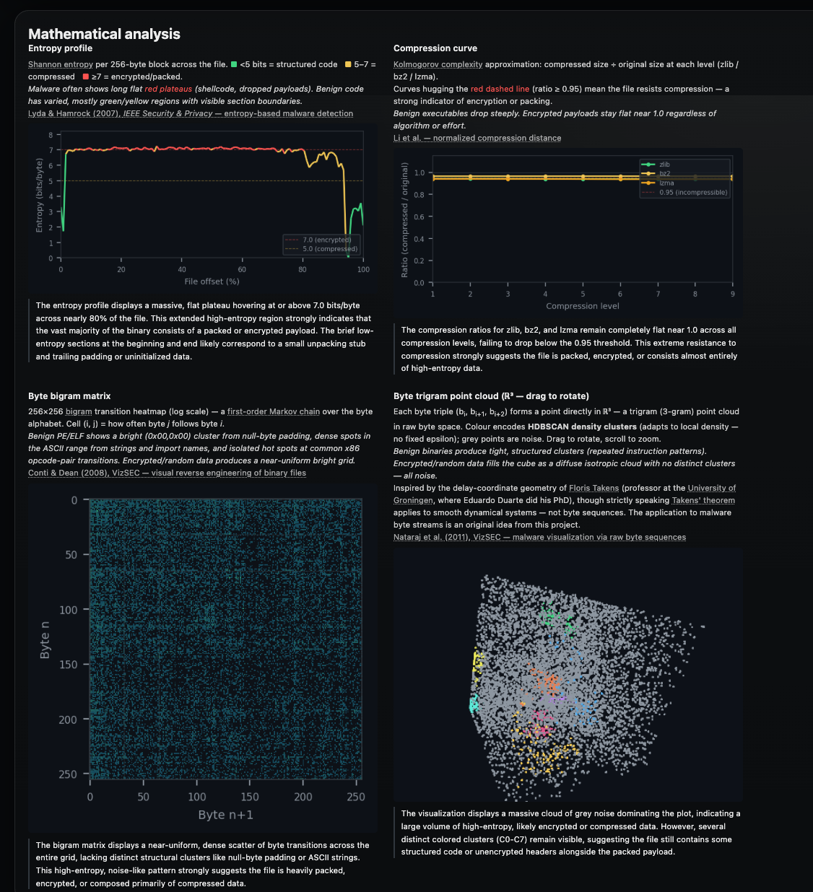

<p align="center">
  
</p>

Self-hosted **malware static triage platform** powered by LLMs.

Upload a suspicious file or paste a URL — malhaus runs it through a pipeline of static analysis tools (radare2, strings, FLOSS, objdump, pefile, oletools, binwalk, exiftool, mupdf, tesseract, optional Ghidra…), feeds the results to an LLM of your choice, and returns a structured verdict with confidence score, key reasons, and full tool output.

**Live demo:** [https://grothendieck.ff2.nl](https://grothendieck.ff2.nl)



---

## Features

### Supported inputs

| Category | Formats | What is done |
|----------|---------|--------------|
| Windows executables | PE/PE32+ (EXE, DLL, SYS), DOS `.com` | Headers, sections + per-section entropy, imports/imphash, overlay, version info, Authenticode chain + signer, radare2 entry-point disassembly, FLOSS strings, binwalk; **UPX** auto-unpack; **.NET** metadata (dnfile) — Assembly.Load, injection/AV-tamper APIs, embedded resources, obfuscated names |
| Linux executables | ELF | readelf, dynamic symbols, `ldd`, disassembly, FLOSS, binwalk, UPX unpack |
| Office | OLE (DOC/XLS/PPT), OpenXML (DOCX/XLSX/PPTX, macro-enabled), RTF | olevba macros, oledump streams, oleobj/rtfobj embedded objects (extracted and analysed in turn), OpenXML part listing, remote-template / external-OLE injection |
| PDF | PDF | pdfid / pdf-parser structure, JavaScript/actions, text layer, links, password form fields, OCR of image-only pages |
| E-mail | `.eml`, Outlook `.msg` | From / display name / Reply-To / Return-Path, SPF/DKIM/DMARC, Received chain, body links, attachments saved and analysed with the right tool |
| Scripts | PowerShell, VBS/VBE, HTA, JavaScript, shell/batch, **Perl/CGI, Python, Ruby, PHP, JSP/ASP web shells** | Content review, JS beautify, embedded base64 payload extraction; detected by shebang / `<?php` / `<%` markers / extension / `file(1)`, also without an extension |
| Shortcuts | Windows `.lnk` | LnkParse3, exiftool, LECmd (when installed): target, arguments, hidden command lines |
| Installers | MSI, Inno Setup, NSIS | MSI table/file inventory with entropy; PEs inside get full PE analysis (+ .NET, + Ghidra if enabled); Inno (innoextract) and NSIS (7z) payloads unpacked and the bundled payload inspected, not just the stub |
| Java | JAR / WAR / EAR | Manifest, `jarsigner` verification, class list, `javap` disassembly, inner JARs |
| Archives | ZIP, 7z, RAR (gzip/tar and further archives nested inside are unpacked too) | **Password-protected** archives (password field in UI/API), decompression-bomb check, the most interesting inner file is **promoted** and analysed (PE > ELF > MSI > Office > script > PDF > LNK); double extensions like `evil.jsp.txt` are seen through |
| URLs | `http(s)://…` | Downloaded server-side (size-limited) and analysed like an upload |

### Phishing & network intelligence

- **Phishing analysis** for PDF, DOCX/XLSX/PPTX and e-mail — visible link text vs real target, brand lookalike / homoglyph domains, URL shorteners, credential (password) forms, remote templates, risky attachments (double extensions, executables), lure wording (urgency, account suspension, invoices, gift cards/crypto…) plus an LLM read of the text; scored 0–100 with weighted signals
- **Text-as-image lures are caught** — image-only PDFs and pictures embedded in e-mails/documents (inline `cid:` images, image attachments, HTML `data:` URIs, OOXML media) are OCR'd (tesseract, or the vision LLM as fallback); tracking pixels are ignored
- **QR codes** in images and PDF pages are decoded (zbarimg) — QR phishing ("quishing") raises the score
- **Network artifacts** — validated URLs / domains / IPs from ASCII + UTF-16 + FLOSS strings, classified as benign infrastructure (CRL/OCSP, schemas, vendor hosts — filtered out), abused services (paste sites, tunnels, file hosting) or unknown; network-capable imports (download-to-file, sockets, recon APIs) listed; code identifiers such as `System.SysUtils` are not mistaken for domains
- **Domain age** via RDAP (whois fallback) for embedded, sender and link domains — newly registered or unregistered domains raise the score. Only domain names leave the server, never the sample (`MALHAUS_DOMAIN_AGE_LOOKUP=0` for air-gapped hosts)

### Verdict engine

- **Preflight**: mandatory tools for the detected file type always run first; supplementary tools are offered to the LLM, filtered by file type and by what is actually installed
- **Deterministic heuristic score** — entropy, IOC-shaped and encoded strings, embedded payloads, network signals, PE compile timestamps in the future, `/Brepro` reproducible builds, unsigned binaries claiming Microsoft authorship, self-signed certificates, version-info company vs Authenticode signer mismatch, catalog-signed Windows binaries, UPX-packed legitimate software, .NET dropper/RAT patterns, installer and phishing findings
- **Strings Analyst LLM** — a separate LLM pass scores the extracted strings (assembler noise filtered out)
- **Tool-calling LLM loop** — the model can run further tools, including on files extracted from the sample (`path` argument); repeated calls force a verdict; a verdict is rejected until the required tools for that type have run
- **Resilience** — fallback model and recovery verdict from the gathered tool context if the LLM fails mid-loop; Azure/OpenAI content-filter hits are retried with a metadata-only call (and treated as a malicious signal); robust JSON parsing of verdicts
- **Output**: `benign` / `suspicious` / `likely_malware` with confidence, top reasons, IOCs, heuristic + strings scores, the tools used for the verdict, full tool output, and (optionally) the LLM debug trace
- All CLI tools run sandboxed with **firejail** (no network, read-only filesystem, private /tmp) when available

### Platform

- Supports **Gemini, OpenAI, Azure AI Foundry (API key or Entra ID / RBAC), Claude (direct or via Azure), DeepSeek**, and any OpenAI-compatible server (Ollama, vLLM, LM Studio)
- **Web UI** — file upload or URL, archive password, Ghidra toggle, live progress log (SSE), recent analyses, captcha gate, per-IP hourly limit and global concurrency limit; the running git commit is shown in the header
- **Reports** — HTML report per SHA-256 plus raw JSON at `/report/<sha256>/json`; results are **cached by SHA-256**, so re-submitting a file is instant
- **REST API** (`/api/v1`) — async jobs, two-step staged upload, SHA-256 lookup, Bearer API keys with per-key rate limits and expiry, optional visualizations as base64 PNGs; Python client example on `/api-docs`
- **MCP server** — AI agents (Claude, Cursor, Continue…) call `analyze_file`, `analyze_url` and `analyze_sha256` over Streamable HTTP, proxied by nginx on 443
- **Admin dashboard** (`/admin`) — create / revoke API keys (label, rate limit, expiry), delete analyses, change password; captcha + brute-force lockout, session timeout, CSRF protection
- **Mathematical analysis visualizations** — entropy profile, compression curve, bigram matrix, and a 3D byte-trigram point cloud with HDBSCAN density clustering (see below)
- Optional **Ghidra** headless decompilation (PE/ELF, also on PEs extracted from MSI/archives)
- Deploy with **Docker** (nginx + gunicorn) or bare metal

### Mathematical analysis

Every file is analysed through four independent visualizations derived purely from its byte sequence:

- **Entropy profile** — sliding-window [Shannon entropy](https://en.wikipedia.org/wiki/Entropy_(information_theory)) plotted across the file offset. Flat high-entropy regions indicate compression or encryption; structured dips reveal headers, overlays, or plaintext sections. See also [Lyda & Hamrock (2007), IEEE Security & Privacy — entropy-based malware detection](https://ieeexplore.ieee.org/document/4140989).
- **Compression curve** — the file is compressed at every level with zlib, bz2, and lzma. The resulting ratio curves distinguish truly random data (flat near 1.0) from structured or already-compressed content. Grounded in [Kolmogorov complexity](https://en.wikipedia.org/wiki/Kolmogorov_complexity).
- **Bigram matrix** — a 256×256 [bigram](https://en.wikipedia.org/wiki/Bigram) transition heatmap (log scale) — a [first-order Markov chain](https://en.wikipedia.org/wiki/Markov_chain) over bytes. Packed or encrypted files produce uniform noise; executables and documents leave recognisable diagonal and off-diagonal patterns that fingerprint the file format. See [Conti & Dean (2008), VizSEC — visual reverse engineering of binary files](https://www.semanticscholar.org/paper/Visual-Reverse-Engineering-of-Binary-and-Data-Files-Conti-Dean/854055131cb3f029ccf2ea2f7ce8aa675d5d8f6e).
- **Byte-trigram point cloud** *(experimental)* — every overlapping triple of bytes `(b[i], b[i+1], b[i+2])` is treated as a 3D coordinate. This is an experimental application of delay-coordinate embedding to malware byte streams, inspired by [Floris Takens](https://en.wikipedia.org/wiki/Floris_Takens) and [Takens' theorem](https://en.wikipedia.org/wiki/Takens%27s_theorem) — a theorem originally developed for reconstructing strange attractors in dynamical systems, not for file analysis. PCA reduces the cloud to 2D and HDBSCAN groups points into density clusters, each rendered in a distinct colour. The resulting geometry is visually suggestive of structural regions (null padding, code, strings, overlays) but has not been formally validated as a classifier. See also [Nataraj et al. (2011), VizSEC — malware visualization via raw byte sequences](https://dl.acm.org/doi/10.1145/2016904.2016908).

All four charts are interpreted by the LLM as part of the triage pipeline.



---

## Quick start — Docker (recommended)

```bash
# 1. Install Docker
curl -fsSL https://get.docker.com | sh
sudo usermod -aG docker $USER && newgrp docker

# 2. Clone
git clone https://github.com/toorandom/malhaus
cd malhaus

# 3. Configure
cp .env.example .env
# edit .env — set MALHAUS_SECRET_KEY and your LLM provider + key

# 4. Point nginx at your domain (replace youractualdomain.org with your real domain)
sed -i 's/your-domain.com/youractualdomain.org/g' nginx/nginx.conf

# 5a. Get a TLS certificate — public domain (Let's Encrypt)
sudo apt install -y certbot
sudo certbot certonly --standalone -d youractualdomain.org

# 5b. OR — self-signed certificate for internal/air-gapped deployments
#     (browser will warn; add the cert to your internal CA trust store to silence it)

# Generate the certificate (valid 10 years, includes server IP and optional DNS name)
mkdir -p certs
openssl req -x509 -newkey rsa:4096 -sha256 -days 3650 -nodes \
  -keyout certs/privkey.pem -out certs/fullchain.pem \
  -subj "/CN=malhaus" \
  -addext "subjectAltName=IP:$(hostname -I | awk '{print $1}'),DNS:malhaus.internal"

# Point nginx to the self-signed certs instead of Let's Encrypt paths
sed -i 's|ssl_certificate .*|ssl_certificate     /etc/nginx/certs/fullchain.pem;|' nginx/nginx.conf
sed -i 's|ssl_certificate_key .*|ssl_certificate_key /etc/nginx/certs/privkey.pem;|' nginx/nginx.conf

# Mount the certs folder into the nginx container (replace the letsencrypt mount)
sed -i 's|- /etc/letsencrypt:/etc/letsencrypt:ro|- ./certs:/etc/nginx/certs:ro|' docker-compose.yml

# 6. Build and start
docker compose up -d --build
docker compose logs -f
```

The app is now reachable at `https://youractualdomain.org` (or `https://<server-ip>` for self-signed).

See [START.md](START.md) for the full deployment guide including updates, backups, moving to another machine, and troubleshooting.

---

## Quick start — bare metal / development

```bash
sudo ./install_system.sh       # apt packages: radare2, yara, ssdeep, oletools, etc.
sudo ./install_additional.sh   # osslsigncode, captcha/pillow dependencies
./install_python.sh            # creates .venv and installs Python packages

cp config.source.example config.source
nano config.source             # set MALHAUS_LLM_PROVIDER, MALHAUS_LLM_API_KEY, MALHAUS_SECRET_KEY

./run.sh                       # sources config.source and starts gunicorn on 127.0.0.1:8000
```

---

## Analysis tools

The pipeline runs mandatory tools automatically in preflight (every submission) and makes supplementary tools available for the LLM to call on demand during the verdict loop.

### System tools (apt)

| Tool | Usage | Purpose | File types |
|------|-------|---------|------------|
| `strings` / `file` / `binutils` | Mandatory | String extraction, file type detection, objdump | All |
| `radare2` | Mandatory | Disassembly, entry point analysis, PE/ELF info | PE, ELF |
| `elfutils` | Mandatory | ELF analysis (`readelf`) | ELF |
| `pev` / `osslsigncode` | Mandatory | PE section info, Authenticode verification | PE |
| `binwalk` | Mandatory | Embedded file signature scanning — finds payloads appended to or hidden inside binaries | PE, ELF |
| `p7zip` | Mandatory | Archive extraction | ZIP, 7z, RAR… |
| `firejail` | Mandatory | Sandbox wrapper for CLI tools | All |
| `nodejs` / `js-beautify` | Mandatory | JavaScript deobfuscation | JS |
| `upx` | Mandatory | Unpack UPX-compressed binaries before analysis | PE, ELF |
| `mupdf-tools` | Mandatory | PDF text layer, link extraction, page rendering for OCR | PDF |
| `tesseract-ocr` | Optional | OCR of image-only PDFs and embedded images (vision LLM is used when missing) | PDF, e-mail, Office |
| `zbar-tools` | Optional | QR-code decoding in images and PDF pages | PDF, e-mail, Office |
| `whois` | Optional | Domain-age fallback when RDAP has no answer | All |
| `innoextract` | Optional | Inno Setup installer unpacking | PE installers |
| `ssdeep` | Supplementary | Fuzzy hashing — find similar files across malware families | All |
| `exiftool` | Supplementary | Metadata extraction | LNK |
| `openjdk-21` *(Docker)* | Optional | `jarsigner` / `javap` for Java archives; required by Ghidra headless | JAR/WAR/EAR, PE, ELF |

### Python libraries (pip)

| Library | Usage | Purpose | File types |
|---------|-------|---------|------------|
| `oletools` (oledump, olevba, oleobj, rtfobj) | Mandatory | OLE/VBA macro analysis, object extraction | Office, RTF |
| `flare-floss` | Mandatory | Deobfuscated string extraction (stack strings, encoded strings) | PE, ELF |
| `pefile` | Mandatory | PE header/section/import parsing | PE |
| `dnfile` | Mandatory | .NET metadata analysis — type refs, Assembly.Load, embedded resources, obfuscation | .NET PE |
| `LnkParse3` | Mandatory | Windows shortcut parsing | LNK |
| `olefile` | Mandatory | Outlook `.msg` parsing | E-mail |
| `Pillow` | Mandatory | Image normalisation for OCR / QR decoding | PDF, e-mail, Office |

### Didier Stevens tools (downloaded at build time)

| Tool | Purpose | File types |
|------|---------|------------|
| `oledump.py` | OLE stream analysis | Office |
| `pdfid.py` | PDF structure analysis | PDF |
| `pdf-parser.py` | PDF object extraction | PDF |

### Optional: Ghidra headless (requires manual install)

Ghidra decompiles functions, scores suspicious API combinations (injection, persistence, C2 indicators), and extracts IOCs from binary code. See [Ghidra integration](#ghidra-integration-optional) below.

---

## LLM providers

Set `MALHAUS_LLM_PROVIDER` in `.env` (Docker) or `config.source` (bare metal):

| Provider | Value | Notes |
|----------|-------|-------|
| Google Gemini | `gemini` | Default. `gemini-2.5-flash` / `gemini-2.5-pro` |
| OpenAI | `openai` | `gpt-4o-mini` / `gpt-4o` |
| Azure AI Foundry (OpenAI) | `azure` | Set `MALHAUS_LLM_ENDPOINT` to your Azure endpoint |
| Azure AI Foundry (Claude) | `claude` | Set `MALHAUS_LLM_ENDPOINT` + `MALHAUS_AZURE_USE_ENTRA_ID=1` for keyless Entra ID auth |
| Anthropic Claude (direct) | `claude` | `claude-haiku-4-5-20251001` / `claude-sonnet-4-6` |
| DeepSeek | `deepseek` | `deepseek-chat` |
| Any OpenAI-compatible | `openai` | Set `MALHAUS_LLM_ENDPOINT` (Ollama, vLLM, LM Studio…) |

See `.env.example` for full configuration examples including Azure AI Foundry Entra ID setup.

---

## Ghidra integration (optional)

Ghidra headless decompilation adds a deeper static analysis pass for PE and ELF files — it decompiles functions, scores suspicious API combinations, and extracts embedded indicators (IPs, URLs, registry keys).

**Requires:** Ghidra 11+ installed on the **host** machine.

### Docker

1. Install Ghidra on the host (e.g. `/opt/ghidra`). Java 21 is already baked into the image.
2. The `docker-compose.yml` mounts `/opt/ghidra` from the host into the container automatically.
3. Add to `.env`:
   ```
   MALHAUS_GHIDRA_DIR=/opt/ghidra
   ```
4. Rebuild: `docker compose up -d --build`

### Bare metal

1. Install Ghidra and Java 21 (`sudo apt install openjdk-21-jdk-headless` on Ubuntu 24.04+).
2. Add to `config.source`:
   ```
   export MALHAUS_GHIDRA_DIR=/opt/ghidra
   export JAVA_HOME=/usr/lib/jvm/java-21-openjdk-amd64
   ```

### Enabling per analysis

- **Web UI:** check the **Use Ghidra** checkbox before submitting.
- **REST API:** pass `use_ghidra=1` as a form field:
  ```bash
  curl -X POST https://your-server/api/v1/analyze \
    -H "Authorization: Bearer mh_YOUR_KEY" \
    -F "file=@sample.exe" \
    -F "use_ghidra=1"
  ```

Ghidra analysis typically takes 1–3 minutes per file.

---

## API & MCP

All API responses are **JSON**. Submitting a file returns a `job_id` immediately; you poll `GET /api/v1/jobs/<job_id>` until done:

```json
{
  "status":          "done",
  "sha256":          "e3b0c442...",
  "report_url":      "/report/e3b0c442...",
  "verdict": {
    "risk_level":    "likely_malware",
    "confidence":    92,
    "file_type":     "PE32 executable"
  },
  "heuristic_score": 74,
  "top_reasons":     ["High entropy sections consistent with packing", "..."],
  "tools_used":      ["mandatory_authenticode_verify", "mandatory_objdump_pe_headers", "..."],
  "tool_outputs":    { "mandatory_authenticode_verify": { "stdout": "...", "error": null } }
}
```

Add `?include=images,takens2d` to also receive the entropy profile, compression curve, bigram matrix, and trigram point cloud as base64 PNGs with LLM interpretations.

Every web report also exposes its raw JSON at `GET /report/<sha256>/json` — no authentication needed. A **JSON ↗** link appears on every report page.

- [REST API reference](README-API.md) — full endpoint docs, all request/response formats, curl and Python examples
- [MCP server](README-MCP.md) — connect Claude Desktop, Cursor, Continue, or any MCP client
- [API key management](README-API-KEY-MGNT.md) — create, list, revoke keys
- [Adding a new analysis tool](README-CREATE-NEW-TOOL.md) — extend the pipeline

---

## License

MIT — Copyright (c) 2026 Eduardo Ruiz Duarte &lt;toorandom@gmail.com&gt;
